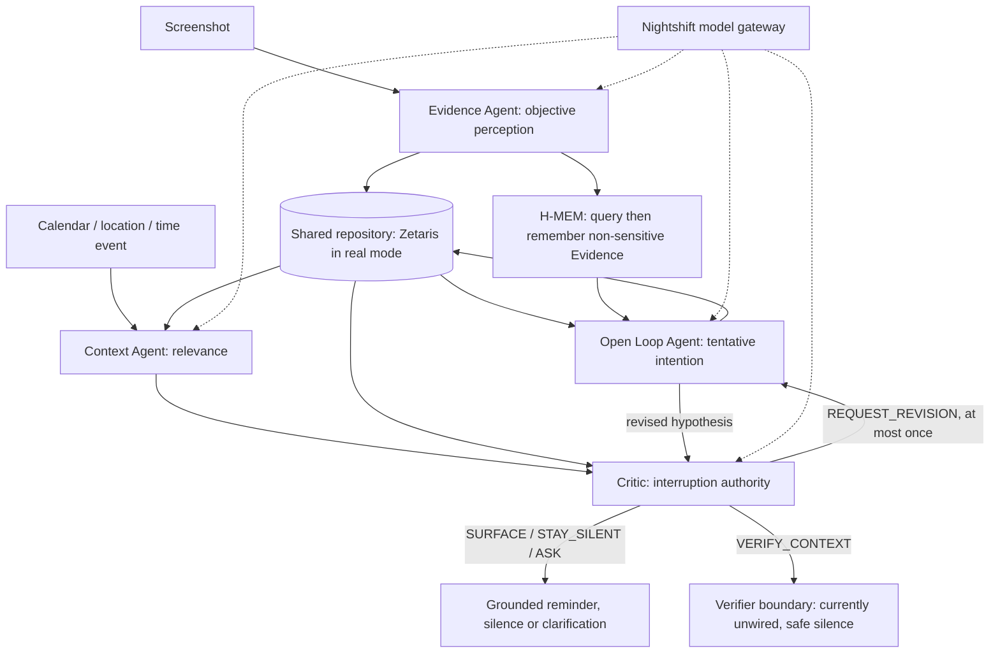

# Pingo (repository and code name: Recall)

> The product is called **Pingo**. The repository, code, API and these docs say "Recall" for the same system.

**Saved screenshots → grounded intentions → reminders when they are useful.**

People save places, products and trips in screenshots, then forget them when the relevant moment arrives. Recall helps someone deciding where to eat, what to revisit or where to go recover that saved context. A screenshot is evidence of interest, never proof of a plan. A Critic can stop an interruption or send an unsupported interpretation back for revision.

*No Recall without evidence. No interruption without context.*

**Primary track: Reasoning Architecture.** Memory expands what the agents can retrieve; shared evidence grounds decisions; the Critic can block or revise them. Measured on 20 synthetic events with real models: 9/10 relevant moments surfaced, 0/10 unrelated interruptions, every reminder cites existing Evidence ([impact](docs/impact.md)). No user study has been run.

## Try it without credentials

With Docker and Compose installed, from the repository root:

```sh
docker compose up --build
```

Open **http://localhost:5175**. The guide on Home has a **Try it** tab: save a bundled screenshot, simulate a place or calendar event, or let the agents review look-alike intentions, and watch each agent step appear. Then open **Agent Activity** (`/agent-activity`) for the full trace. No `.env`, host Node, GPU, Zetaris, Nightshift or provider keys are needed. The first build downloads dependencies. Stop with `docker compose down`. If ports are occupied, use `RECALL_BACKEND_PORT=18120 RECALL_FRONTEND_PORT=15175 docker compose up --build`, then open port 15175.

Sample browsing uses a committed historical snapshot: **30 Evidence, 65 entities, 17 active Open Loops**. Seven cases replay captured Nightshift replies through the existing agents, parsers, validators and persistence boundaries. Context/revision use the unchanged orchestrator. Ingestion composes its existing agent and ingestion APIs with fixed IDs and a frozen clock. H-MEM query/store responses are recorded too; its engine does not run during replay.

Every example says **Recorded real run, replayed** (`provenance: recorded`, `workspace: sample`). Receipts describe the original capture. Test screenshots and calendar inputs are synthetic; the revision title and six-loop duplicate fixture are controlled synthetic inputs. Historical screenshot content is sample data, not a confirmed user goal. **Replay demonstrates execution of known cases, not fresh model reasoning.** Without model access, arbitrary uploads/context inputs are disabled and input drift fails closed. If you set `METERLESS_BASE_URL` (and key/models) in `backend/.env`, sample mode also accepts your own screenshot and context events through the same agents with real model calls (runs are labelled `live`), still on the in-memory sample workspace. [How capture and replay work](backend/demo/recordings/README.md).

| Case | Observed output |
| --- | --- |
| `attach` | Another Elmo's screenshot attaches to its existing loop; H-MEM retrieves earlier Evidence |
| `create` | Kiwami creates a new tentative interest |
| `sensitive` | Sensitive test screenshot is ignored by reasoning and memory; content withheld |
| `surface` | Dinner with Alex in Fitzroy North → Context MATCH → Critic SURFACE |
| `restraint` | Pick up dry cleaning → NO_MATCH → STAY_SILENT |
| `revision` | Unsupported booking title → REQUEST_REVISION → REVISE → SURFACE |
| `duplicates` | Synthetic look-alikes → ASK/Check-in, MERGE and KEEP_SEPARATE |

API examples (Docker backend is on port 8000):

```sh
curl http://localhost:8000/api/sample/cases
curl -X POST http://localhost:8000/api/sample/cases/revision/replay
curl http://localhost:8000/agent-events/run_sample_revision
```

The API returns structured decisions, evidence references, concise reasons and receipts. It does not request or show chain of thought. [Complete API](docs/api.md).

## Modes: switching between sample and live

| Mode | Start | Open | Needs |
| --- | --- | --- | --- |
| **Sample** (default, offline) | `docker compose up --build` | http://localhost:5175 | Nothing. No keys. |
| **Sample + your own input, real models** | Create `.env` at the repo root (below), then `docker compose up --build` again | http://localhost:5175, then the **+ Save screenshot** button (bottom right, opens `/sync`) | A Meterless Nightshift instance |
| **Demo** (no Docker; real models, resettable) | `backend/.env` with `METERLESS_*`, then the two commands below | http://localhost:5175 (**+ Save screenshot** opens `/sync`) | Nightshift, Python, Node |
| **Full** (real Zetaris data) | `docker compose -f compose.yaml -f compose.zetaris.yaml up --build` or `serve.py --env-file backend/.env` | http://localhost:5175 | Zetaris platform + Nightshift |

```sh
# .env at the repo root (never committed). From Docker, a Nightshift on your machine is reached through host.docker.internal.
METERLESS_BASE_URL=http://host.docker.internal:8088/v1
METERLESS_API_KEY=
METERLESS_VISION_MODEL=gpt-4o-mini
METERLESS_REASONING_MODEL=nvidia/nemotron-3-ultra-550b-a55b
```

```sh
# Demo mode without Docker: backend on 8100, frontend pointed at it
backend/.venv/bin/python backend/scripts/serve.py --demo
cd frontend && npm ci && VITE_API_BASE_URL=http://localhost:8100 npm run dev -- --host 127.0.0.1 --port 5175
```

The **+ Save screenshot** button only appears where uploading is allowed (demo workspace, or sample with live models). The real-data backend (Zetaris) never shows it, because Evidence there is append-only and permanent.

**Docker and Nightshift:** the container reaches a Nightshift on your machine through `host.docker.internal` (verified on Docker with Colima, macOS). On Linux that name points to the Docker bridge, so a Nightshift bound only to `127.0.0.1` is not reachable; bind it to `0.0.0.0`, or use the Python demo mode above.

**Back to sample:** delete (or rename) the root `.env` and run `docker compose up --build` again, or stop the demo servers. The page header says which mode you are in, and every run is labelled `recorded` (replayed capture) or `live` (real model calls). `POST /api/sample/reset` (sample) and `POST /api/demo/reset` (demo) restore the saved history.

`SAMPLE_MODE=false` without Zetaris does **not** fall back to sample data: the backend reports that storage is unavailable.

## Run with Python

Requires Python 3.10+ (Docker uses 3.11):

```sh
python3 -m venv backend/.venv
backend/.venv/bin/python -m pip install -r backend/requirements-server.txt
SAMPLE_MODE=true backend/.venv/bin/python backend/scripts/run_sample.py
SAMPLE_MODE=true backend/.venv/bin/python backend/scripts/serve.py --host 127.0.0.1 --port 8120
```

The first sample command prints all seven runs as JSON. The second serves the API at http://localhost:8120. No Java/JDBC service is started in sample mode.

Optional frontend development, in a second terminal (Node 22.12+; this points the UI at the sample server above):

```sh
cd frontend
npm ci
VITE_API_BASE_URL=http://localhost:8120 VITE_CHECKIN_DEMO=false npm run dev -- --host 127.0.0.1 --port 5175
```

## Agents and feedback



| Agent | Authority |
| --- | --- |
| Evidence | Extracts visible facts and flags sensitive screenshots |
| Open Loop | CREATE / ATTACH / REVISE / RESOLVE / IGNORE / LEAVE_UNRESOLVED |
| Context | MATCH / NO_MATCH / NEEDS_VERIFICATION over saved active loops |
| Critic | SURFACE / STAY_SILENT / ASK / REQUEST_REVISION / VERIFY_CONTEXT; also duplicate review |

`RecallOrchestrator` sequences these agents; it is not another agent. Calls retry once, revisions and verification are bounded to one each, unknown references are rejected, and failures end safely. Context evaluation uses a read-only overlay; the notification service persists only explicit delivery actions. Duplicate uncertainty becomes a daily Check-in; the person's answer settles a merge. [Agent docs](docs/agents/README.md) · [architecture and live proof](docs/architecture/agent-orchestration.md).

## Live configuration and the resettable demo

1. Copy `backend/.env.example` to ignored `backend/.env` and configure the Nightshift URL/token and the exact vision/reasoning models advertised by your instance. NVIDIA/OpenAI provider keys belong **only inside Nightshift's Providers settings**; Recall has no direct-provider fallback.
2. For canonical mode, configure Zetaris JDBC URL, driver JAR, username/password and `JAVA_HOME` following [Zetaris setup](backend/ZETARIS_INTEGRATION.md). The launcher loads an explicit `--env-file backend/.env`; never commit it.
3. Optional live memory: `cd engines/hmem && npm ci --ignore-scripts`, then `./node_modules/.bin/tsx server.ts`. Set `RECALL_HMEM_URL=http://127.0.0.1:8300`. [H-MEM setup](engines/hmem/README.md).

```sh
# Canonical: real models and permanent Zetaris writes
backend/.venv/bin/python backend/scripts/serve.py --env-file backend/.env
# Demo: real models, resettable in-memory historical snapshot, port 8100
backend/.venv/bin/python backend/scripts/serve.py --demo
```

For recording, use `--demo`, point the frontend at port 8100, and open `/sync`. Use a separate memory sidecar for that workspace ([operations](docs/operations.md)). Never upload test screenshots to canonical Zetaris: Evidence is append-only. `POST /api/demo/reset` resets only the demo workspace. Sample and demo runs never mix with canonical runs.

## Checks

```sh
backend/.venv/bin/python -m unittest discover -s backend/tests
cd frontend
npm ci
npm run build
```

The Python suite has **287 tests**. Two live Zetaris tests skip by default. Four real-engine tests additionally require the H-MEM Node dependencies; without them those tests skip, or set `RECALL_SKIP_REAL_HMEM=1`. No live model calls are made by the suite. The frontend build includes typechecking. H-MEM's own tests and conformance commands are in its [README](engines/hmem/README.md).

## Evidence of behaviour

- **Traces:** every run appends JSON Lines to `logs/trace.jsonl` (agent, action, input/output summary, target agent, retry count, status, model receipt) and echoes key events to stdout. Example traces: [`logs/examples/`](logs/examples).
- **Five examples** with inputs, real recorded outputs and traces: [`input_examples/`](input_examples), [`output_examples/`](output_examples). Regenerate with `backend/scripts/export_examples.py`. They cover attach with memory, a Critic-forced revision, a surfaced reminder, a deliberate silence and a Check-in.
- **Measured behaviour:** [docs/impact.md](docs/impact.md) and [docs/benchmark.json](docs/benchmark.json).
- **Locations:** after an upload a saved place is resolved on OpenStreetMap (strict, unambiguous matches only). When the map's place index does not know it (many small shops), a **Location Agent** searches the web, a model reads the street address out of the snippets, the address is checked to literally appear in the cited snippet, and it is geocoded on OpenStreetMap, which must return the same house number, road and suburb. Only a verified address becomes a coordinate, with its web source and map object recorded ([phone demo](docs/phone-demo.md)).
- **Zetaris:** the sample server is offline, so the guide's *Zetaris* tab shows a read-only capture of the real instance (`backend/scripts/zetaris_proof.py`): table counts and the queries the agents run.

## Zetaris Unified Semantic Layer

Beyond storing Pingo's memory, we built a **Unified Semantic Layer** on Zetaris: one vocabulary over three sources (the Iceberg lakehouse, a CSV map directory
and a JSON agent-decision log), five logical tables with keys, live queries through the USL, and four data-quality rules that run. One of them found a real
defect in our own app. See [docs/usl](docs/usl/README.md); rebuild it with `backend/.venv/bin/python backend/scripts/usl_build.py` (needs the Zetaris platform up).
The three reflection documents are there too: [time saved](docs/usl/2a-time-saved.md), [would it help](docs/usl/2b-would-it-help.md),
[a product requirement for Zetaris](docs/usl/2c-product-requirement.md).

## Sponsor technology and limits

Zetaris stores grounded Evidence, entities, links, loops and feedback through the JDBC repository. Meterless **H-MEM** expands entity-linked retrieval with governed, provenance-bearing memory. **Nightshift** routes every model call; **NVIDIA Nemotron 3 Ultra** handles Open Loop, Context and Critic decisions, while GPT-4o-mini handles perception through Nightshift. [Detailed integration and verified evidence](docs/sponsors.md).

Limitations: food/shopping/travel only; intentions remain hypotheses; privacy filtering for context is a word list; geographic matching needs verified coordinates; no web/news scout; VERIFY_CONTEXT currently ends safely without a real verifier. H-MEM's reference embedder is a hash mock, with noisy marginal matches—not advanced semantic search. Without Nightshift access, sample mode answers only its bundled examples. Live model output can fail schema validation and fail safely; the demo video must show an actual live run.

Pre-existing components: Meterless H-MEM's Apache-2.0 reference source/tests are vendored unmodified at commit `1742dec56a66e58eef9dda2d2b865823758ca8cd` ([notice](engines/hmem/NOTICE.md)). Third-party Python/npm dependencies are declared in requirements and package files. Recall's adapter, agent integration and app code are the hackathon work. No claim of Cursor usage is made.
