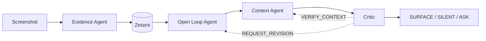

# Recall

Recall turns saved screenshots into grounded reminders. It extracts objective **Evidence**, infers tentative **Open Loops** (unfinished intentions), and only surfaces one when something happening now makes it relevant and a **Critic** agrees it is worth the interruption. *No Recall without evidence. No interruption without context.*



Details: [agent docs](docs/agents/README.md) and [agent orchestration](docs/architecture/agent-orchestration.md).

| Sponsor | Role |
| --- | --- |
| Zetaris | Grounded shared data/state layer: Evidence, entities, relationships, Open Loops (not an agent) |
| Meterless Nightshift | Model gateway and router for every model call |
| NVIDIA Nemotron | Reasoning for the Open Loop, Context and Critic agents |
| OpenAI GPT-4o-mini | Screenshot perception for the Evidence Agent, routed through Nightshift |

The frontend lives in [`frontend/`](frontend/); the agents and API live in [`backend/`](backend/).

## Run the backend

**Sample mode** (offline, in-memory, labelled synthetic fixtures, no Zetaris and no model calls):

```sh
SAMPLE_MODE=true backend/.venv/bin/python backend/scripts/run_sample.py
SAMPLE_MODE=true backend/.venv/bin/python backend/scripts/serve.py
```

**Real mode** needs Zetaris running (see [`backend/ZETARIS_INTEGRATION.md`](backend/ZETARIS_INTEGRATION.md)) and Nightshift at `METERLESS_BASE_URL`. With `env.local` and `backend/.env` configured:

```sh
export JAVA_HOME=/opt/homebrew/opt/openjdk@11/libexec/openjdk.jdk/Contents/Home
backend/.venv/bin/python backend/scripts/zetaris_repository_smoke.py   # read the imported dataset, no model calls
backend/.venv/bin/python backend/scripts/process_open_loops.py         # Open Loop Agent over stored Evidence (resumable)
backend/.venv/bin/python backend/scripts/inspect_open_loops.py         # human-readable result
backend/.venv/bin/python backend/scripts/context_eval.py --suburb "<place from the loop's Evidence>"  # synthetic context vs a real loop
backend/.venv/bin/python backend/scripts/revision_fixture.py           # labelled Critic -> Open Loop -> Critic fixture
backend/.venv/bin/python backend/scripts/serve.py --demo               # resettable demo workspace (port 8100): real models, in-memory data, Zetaris untouched
backend/.venv/bin/python backend/scripts/upload_e2e.py                 # acceptance run against it: upload three images, watch the steps arrive live
backend/.venv/bin/python backend/scripts/daily_check_ins.py            # daily: Critic reviews look-alike loops, merges or files Check-in questions
backend/.venv/bin/python backend/scripts/consolidation_fixture.py      # labelled fixture exercising MERGE / ASK / KEEP_SEPARATE
backend/.venv/bin/python -m unittest discover -s backend/tests         # offline tests
```

## How the agents work (developer notes)

Four agents share one `LoopRepository` (`ZetarisRepository` in real mode). `RecallOrchestrator` sequences them and enforces bounds; it makes no model decisions. Full detail: [agent orchestration](docs/architecture/agent-orchestration.md), per-agent contracts in [docs/agents](docs/agents/README.md).

| Step | Code | Reads | Writes | Decides |
| --- | --- | --- | --- | --- |
| Evidence | `agents/evidence.py` | image | Evidence, entities (append-only) | what is visible |
| Open Loop | `agents/open_loop.py` | Evidence, related Evidence/entities, candidate loops | loops, loop↔entity links | CREATE / ATTACH / REVISE / RESOLVE / IGNORE / LEAVE_UNRESOLVED |
| Context | `agents/context.py` | active loops (max 30), context events | nothing | MATCH / NO_MATCH / NEEDS_VERIFICATION |
| Critic | `agents/critic.py` | loop, Evidence, cited context | nothing | SURFACE / STAY_SILENT / ASK / REQUEST_REVISION / VERIFY_CONTEXT; also `review_duplicates`: MERGE / ASK / KEEP_SEPARATE |
| Consolidation | `orchestration/consolidation.py` | active loops | merges loops; files Check-in questions | nothing (deterministic; the Critic judges, the person answers) |

Rules to keep when changing things:

- An Open Loop is a **hypothesis**. Titles must not state a plan, date or amount the Evidence does not show.
- Every ID a model returns is validated against the IDs it was shown. Invented or malformed IDs fail safe.
- Sensitive Evidence is never sent to reasoning. Resolved, invalidated or dormant loops never surface.
- Failures end in silence (`STAY_SILENT`/`FAILED_SAFE`), never `SURFACE`. Revision and verification are bounded to one each per run; a failed call retries once.
- Every model-backed step records a `TraceEvent` with a sanitized receipt (`requested_model`, `routed_model`, `provider`). No chain-of-thought is stored.
- All model calls go Recall agent → `ModelGateway` → Meterless Nightshift → NVIDIA Nemotron (Evidence uses GPT-4o-mini). There is no direct provider fallback.
- Nightshift has a loose response cache. Every reasoning payload carries a unique `request_id`; keep it, or a similar prompt can return another record's answer.
- Different variants (colourway, size, dish, place) are different loops. Only the exact same item is merged; look-alikes go to the Critic's duplicate review, and uncertain ones to the daily Check-in.
- Check-in questions belong to one day and do not carry over (`GET /api/check-ins` returns today's). Run `daily_check_ins.py` once a day (cron or launchd).
- Every run says where it came from (`provenance`: live / scripted / recorded) and which data it used (`workspace`: canonical / demo / sample). Never show scripted, replayed or hand-written activity as a real run.
- Observability (`app/observe.py`) wraps the gateway, repository and `decide` at the composition boundary. It never changes a decision, it exposes only structured inputs, retrievals, decisions, receipts and state changes (no model reasoning), and a failing observer cannot break a run.
- Context events are synthetic until calendar/location sources exist; label them as test input.
- Web/news search for Context is not implemented.
- Tune behaviour in the prompt and in what the agent is shown (retrieval), then re-run the real-data scripts above and check the receipts. Do not loosen a validator to make output pass.

**Demo machine:** [docs/operations.md](docs/operations.md): `backend/scripts/preflight.py` checks every dependency (PASS/WARN/FAIL with the fix), and `deploy/install_launchd.sh install` makes the API auto-start/restart and keeps the Mac awake.

**API for the UI:** [docs/api.md](docs/api.md) lists every endpoint, including `POST /api/screenshots` (save a screenshot: Evidence → Open Loop, 202 + run_id, observable steps) and `POST /api/context/evaluate` (Context → Critic for events a device reports) and phone access over Tailscale (`RECALL_CORS_ORIGINS`).

**Agent Activity** renders `TraceEvent`s. In real mode, `GET /agent-events/{run_id}` serves saved real runs and `GET /integration-status` reports live Zetaris counts.


## Run locally

Use Node.js 22.12+ (or another version supported by the installed Vite release).

```sh
cd frontend
npm ci
npm run dev
```

Open the local URL printed by Vite. For checks and a production preview:

```sh
npm run typecheck
npm run build
npm run preview
```

## Structure

```text
frontend/
├── public/
├── src/
│   ├── assets/
│   │   ├── images/
│   │   └── icons/
│   ├── components/
│   │   ├── layout/
│   │   │   ├── AppShell.tsx
│   │   │   └── BottomNav.tsx
│   │   └── common/
│   │       ├── PageHeader.tsx
│   │       └── EmptyState.tsx
│   ├── pages/
│   │   ├── home/HomePage.tsx
│   │   ├── checkin/CheckInPage.tsx
│   │   ├── category/CategoryPage.tsx
│   │   └── entity/EntityDetailPage.tsx
│   ├── data/mockData.ts
│   ├── types/recall.ts
│   ├── services/api.ts
│   ├── styles/global.css
│   ├── router/AppRouter.tsx
│   ├── App.tsx
│   └── main.tsx
├── .gitignore
├── index.html
├── package.json
├── package-lock.json
├── tsconfig.json
└── vite.config.ts
```

The empty asset and public directories contain `.gitkeep` files so they survive checkout.

## Routes and fixtures

| Route | Behavior |
| --- | --- |
| `/` | Homepage skeleton with Food, Shopping, and Travel category cards |
| `/check-in` | Ica's question flow with responses, clarification, and pending count |
| `/category/:category` | Reusable category page for `food`, `shopping`, or `travel` |
| `/entity/:entityId` | Entity placeholder using fixture data when available |

Unknown routes and unsupported categories redirect to `/`. Unknown entity IDs, including `/entity/test`, render a safe detail placeholder.

`src/data/mockData.ts` holds three development entities: Ramen A (Carlton, 5 screenshots), Zara Brown Jacket (3 screenshots), and TeamLab Tokyo (2 screenshots). Homepage counts reflect fixture entities, not screenshots. Category entries link to their entity detail pages. Check-in uses browser demo data in development without `VITE_API_BASE_URL`, or when `VITE_CHECKIN_DEMO=true`; otherwise it calls the configured API. Production uses API mode by default. No backend is implemented here. See the [Check-in documentation](frontend/src/pages/checkin/README.md) for configuration and the API contract.

Production hosting will need an SPA fallback to `index.html` for direct links and refreshes on nested routes. Vite's development and preview servers already handle this.

## Parallel development

Once this shared foundation has been committed and pushed, both developers should branch from that same commit:

```sh
# Daffa, in his checkout
git switch -c feature/home

# Ica, in her checkout
git switch -c feature/checkin
```

| Owner | Page directories | Owned sections of `src/styles/global.css` |
| --- | --- | --- |
| Daffa | `src/pages/home/`, `src/pages/category/`, `src/pages/entity/` | 6. Homepage, 7. Categories, 8. Entity Detail |
| Ica | `src/pages/checkin/` | 9. Check-in |

All styling belongs in the **single** `src/styles/global.css`, imported once by `src/main.tsx`. Add page media queries within the relevant owner's section. Do not add page stylesheets, CSS modules, inline styles, or UI frameworks.

Coordinate changes to shared files: CSS tokens/base/layout/components/navigation/responsive sections, `router/`, `components/`, `types/`, `data/`, and `services/`. Keep page classes scoped with `home-`, `category-`, `entity-`, and `checkin-` prefixes. The two developers can evolve their page files and CSS sections independently without changing the router or shell.

When screenshot references arrive, update the relevant owner's pages and CSS sections while retaining the routes, folder structure, and shared types where possible. Homepage remains a placeholder; Check-in implements the question flow. No authentication, uploads, notifications, calendar, location, backend, or agents are implemented.

## Manual navigation check

1. From `/`, select Food; verify `/category/food`, then return Home.
2. Select Shopping; verify `/category/shopping`, then return Home.
3. Select Travel; verify `/category/travel`, then return Home.
4. Use bottom navigation to go Home → Check-in → Home.
5. Open `/entity/test` directly and confirm the safe detail placeholder.
6. Open a known fixture (for example `/entity/food-ramen-a`) and an unknown route; verify detail content and the redirect respectively.

## NVIDIA / Nightshift verification setup

Developer-only NVIDIA smoke tests live in [`backend/`](backend/README.md). The production path is **Recall agent → ModelGateway → Meterless Nightshift → NVIDIA Nemotron**; direct NVIDIA calls exist only to verify a local development credential. Provider credentials for production belong in Nightshift, and routing through our Nightshift instance has been verified with receipts (see [agent orchestration](docs/architecture/agent-orchestration.md#real-proof-verified-in-this-working-tree)).
