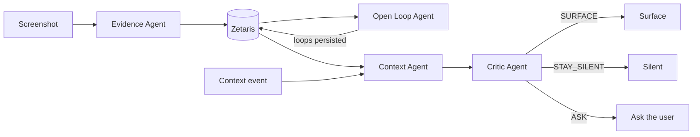
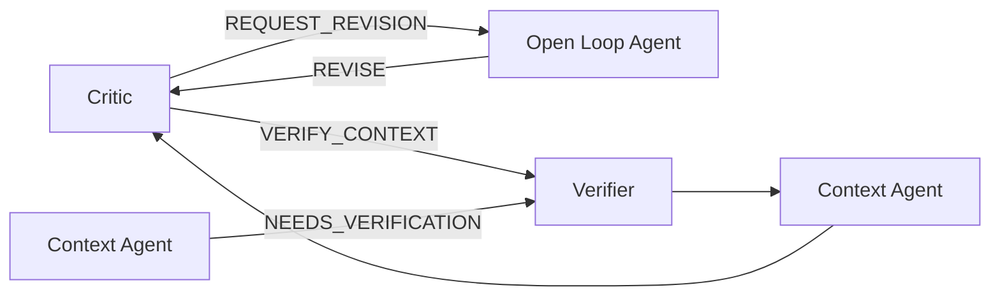

# Agent orchestration

Recall turns screenshots into grounded, explainable reminders. Four specialised agents share one state layer and are sequenced by a thin orchestrator. This document describes what is **implemented** in this repository.

## Main flow



| Stage | Question | Output |
| --- | --- | --- |
| Evidence | What am I looking at? | Objective Evidence + entities |
| Open Loop | What is this person still trying to do? | A hypothesis (Open Loop) and an action: CREATE / ATTACH / REVISE / RESOLVE / IGNORE / LEAVE_UNRESOLVED |
| Context | Does something happening now make it relevant? | MATCH / NO_MATCH / NEEDS_VERIFICATION |
| Critic | Is this worth bothering the user about? | SURFACE / STAY_SILENT / ASK / REQUEST_REVISION / VERIFY_CONTEXT |

## Nonlinear branches



- **Revision:** if the loop states more than the Evidence shows, the Critic returns `REQUEST_REVISION`. The Open Loop Agent may only `REVISE` that loop (or `LEAVE_UNRESOLVED`), then the Critic reviews again. Proven end to end with real models on a labelled fixture (see below).
- **Verification:** if the context itself is unreliable, the orchestrator calls a `ContextVerifier`, then re-runs Context and Critic. The branch is implemented and covered by offline tests. **No real verifier is wired**, so in production it ends in `STAY_SILENT` ("context was not verified"); it has not been exercised live.

## Specialisation boundaries

| Agent | May read | May write |
| --- | --- | --- |
| Evidence | Image | Evidence, entities, links (append-only) |
| Open Loop | Evidence, entities, candidate loops | Open Loops and loop↔entity links, never Evidence |
| Context | Active loops, entities, context events | Nothing |
| Critic | Loop, entities, Evidence, cited context | Nothing |

The orchestrator (`RecallOrchestrator`) is **not an agent**: it makes no model decisions. It sequences agents, enforces bounds and records the trace.

## Shared state

All agents go through one `LoopRepository` contract. In real mode it is `ZetarisRepository`, six Iceberg tables in Zetaris (`evidence`, `entities`, `evidence_entities`, `open_loops`, `loop_entities`, `context_events`). Agents never query Zetaris directly. Zetaris is the grounded data layer, not an agent. `SAMPLE_MODE=true` selects an in-memory repository and is never a silent fallback.

## Bounds and fail-safe silence

- **Bounded retry:** a failed agent call is retried at most once.
- **Bounded revision:** at most one Critic→Open Loop revision per run.
- **Bounded verification:** at most one context verification per run.
- **Fail-safe:** every failure ends in `STORED`, `STAY_SILENT` or `FAILED_SAFE`. Nothing defaults to `SURFACE`. A Context or Critic failure never surfaces; an Open Loop failure leaves Evidence stored and invents no loop.
- Invented or malformed model IDs are rejected by each agent's parser; sensitive Evidence is never sent to reasoning; resolved, invalidated or dormant loops cannot surface.

## Structured TraceEvents

Each step emits a `TraceEvent`: `run_id`, `timestamp`, `agent`, `action`, `reason`, `input_refs`, `next_step`, `output_ref`, `receipt`. Repository reads appear as `ZETARIS` events (for example "Loaded Open Loop with 4 entities and 4 supporting Evidence records from Zetaris") and only when the read happened. Model-backed events carry a sanitized receipt (`requested_model`, `routed_model`, `provider`). The Agent Activity view consumes these via `GET /agent-events/{run_id}`; in real mode `GET /integration-status` reports live Zetaris counts and lists the saved reasoning runs.

## Model routing

```
Recall agent → ModelGateway → Meterless Nightshift → NVIDIA Nemotron 3 Ultra   (Open Loop, Context, Critic)
Recall agent → ModelGateway → Meterless Nightshift → OpenAI GPT-4o-mini        (Evidence, vision)
```

Nightshift is the gateway and router; it does not perform Recall's agent reasoning. Nemotron does the reasoning. There is no direct NVIDIA or OpenAI path, and the gateway refuses NVIDIA endpoints.

## Why this is an agent architecture, not a linear prompt chain

- Agents have **separate responsibilities, contracts and permissions**, and each validates its own structured output.
- **Control flow depends on decisions.** The Critic can send work back to the Open Loop Agent or the Context Agent; the path is chosen at run time.
- They coordinate through **shared persistent state**, not by passing one growing prompt.
- A deterministic orchestrator enforces **bounds and fail-safe behaviour** outside any model.

## Why Recall can explain why

A surfaced Recall can be traced to:

1. the **supporting Evidence** (IDs that exist in Zetaris, each with its screenshot reference),
2. the **inferred Open Loop** (title, status, confidence, linked entities),
3. the **triggering Context** (the cited context event),
4. the **Critic decision**,
5. **concise auditable reasons** from each agent, and
6. **model/provider receipts** for every model-backed step.

> **No Recall without evidence. No interruption without context.**

The Critic's `SURFACE` is rejected unless it cites both Evidence and context. Explainability comes from structured provenance and agent decisions. Hidden chain-of-thought is not requested, stored or exposed.

## Real proof (verified in this working tree)

| Item | Result |
| --- | --- |
| Zetaris data | 30 Evidence, 65 entities, 69 Evidence↔entity links (`backend/scripts/zetaris_repository_smoke.py`) |
| Open Loop run | 22 Evidence reasoned over, 8 skipped locally (unsupported domain), 0 sensitive; 17 `CREATE`, 5 `ATTACH`; 17 Open Loops and 39 loop↔entity links stored; 23 model calls (one retry) |
| Rerun | 0 model calls; Zetaris still holds 30 Evidence, 65 entities, 69 links, 17 loops (no duplicates) |
| Receipts | All reasoning receipts: requested = routed = `nvidia/nemotron-3-ultra-550b-a55b`, provider `nvidia` (via Nightshift) |
| Strong context | Synthetic calendar "Dinner with Alex" (Fitzroy North) vs the real Elmo's Hamburger loop (4 Evidence): Context `MATCH` → Critic `SURFACE`, citing Evidence and context |
| Restraint | Synthetic "Pick up dry cleaning", same suburb, same loop: no Recall surfaced. One run stopped at the Critic (`STAY_SILENT`: geographic overlap alone does not make restaurant interest useful now), a rerun at the Context Agent (`NO_MATCH`). Model output varies between runs |
| Revision | Labelled fixture, over-specific loop "Book a table at OMB Burger tonight at 8pm" over real OMB Burger Evidence: Critic `REQUEST_REVISION` → Open Loop `REVISE` → Critic `SURFACE`; loop retitled to "Interested in OMB Burger (halal, late-night, under $10, Melbourne CBD)". Zetaris was not written |
| Offline tests | 199 passed, 2 live-only skipped |

Synthetic inputs, stated plainly: the calendar events and the over-specific revision loop are test inputs. Everything else (Evidence, entities, loops, model decisions, receipts) is real.

## Not implemented

Live calendar or location sources, `REAL_WORLD_EVENT` retrieval, a real context verifier, persisting user feedback from Check-in, and any automatic loop dormancy.
