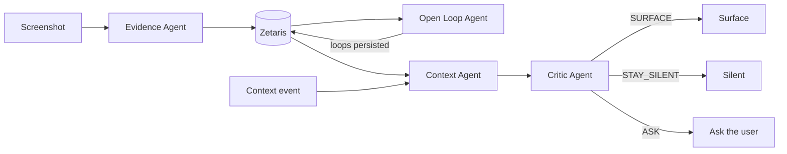
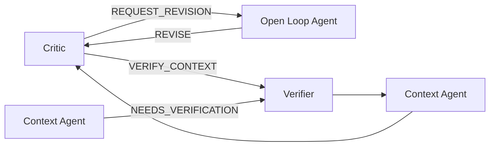
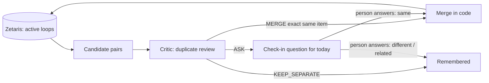

# Agent orchestration

Recall turns screenshots into grounded, explainable reminders. Four specialised agents share one state layer and are sequenced by a thin orchestrator. This document describes what is **implemented** in this repository.

## Main flow



| Stage | Question | Output |
| --- | --- | --- |
| Evidence | What am I looking at? | Objective Evidence + entities |
| Open Loop | What is this person still trying to do? | A hypothesis (Open Loop) and an action: CREATE / ATTACH / REVISE / RESOLVE / IGNORE / LEAVE_UNRESOLVED |
| Context | Does something happening now make it relevant? | MATCH / NO_MATCH / NEEDS_VERIFICATION |
| Critic | Is this worth bothering the user about? | SURFACE / STAY_SILENT / ASK / REQUEST_REVISION / VERIFY_CONTEXT |

## Nonlinear branches



- **Revision:** if the loop states more than the Evidence shows, the Critic returns `REQUEST_REVISION`. The Open Loop Agent may only `REVISE` that loop (or `LEAVE_UNRESOLVED`), then the Critic reviews again. Proven end to end with real models on a labelled fixture (see below).
- **Verification:** if the context itself is unreliable, the orchestrator calls a `ContextVerifier`, then re-runs Context and Critic. The branch is implemented and covered by offline tests. **No real verifier is wired**, so in production it ends in `STAY_SILENT` ("context was not verified"); it has not been exercised live.

## Loop consolidation and daily Check-in

A fourth flow keeps the set of Open Loops tidy. `backend/scripts/daily_check_ins.py` runs it once a day.



- **Candidate pairs** are chosen deterministically (same domain, a shared entity or a shared distinctive name word). No model is involved.
- **The Critic judges only.** `MERGE` means the exact same item (same product *and* colourway, same venue). A different colourway, size, dish or place is not a merge. When unsure it chooses `ASK`; when clearly different, `KEEP_SEPARATE`.
- **Merging is deterministic code**, not a model action: the other loop's entities move to the kept loop and the other loop becomes `INVALIDATED` (hidden, never deleted).
- **`ASK` becomes a Check-in question** stored in the `check_ins` table in Zetaris, with the two loops' screenshots as images. The person's answer decides; only "same" merges.
- **Daily refresh:** a question belongs to one day. `GET /api/check-ins` returns only today's unanswered questions; an unanswered one does not carry over.
- Failure is safe: a failed review changes nothing and the pairs are retried the next day.

## Specialisation boundaries

| Agent | May read | May write |
| --- | --- | --- |
| Evidence | Image | Evidence, entities, links (append-only) |
| Open Loop | Evidence, entities, candidate loops | Open Loops and loop↔entity links, never Evidence |
| Context | Active loops, entities, context events | Nothing |
| Critic | Loop, entities, Evidence, cited context | Nothing |

The orchestrator (`RecallOrchestrator`) is **not an agent**: it makes no model decisions. It sequences agents, enforces bounds and records the trace.

## Shared state

All agents go through one `LoopRepository` contract. In real mode it is `ZetarisRepository`, the core Iceberg graph tables in Zetaris (`evidence`, `entities`, `evidence_entities`, `open_loops`, `loop_entities`, `context_events`), plus persisted context evaluations, notifications and Check-ins. See [the current sponsor/storage inventory](../sponsors.md). Agents never query Zetaris directly. Zetaris is the grounded data layer, not an agent. `SAMPLE_MODE=true` selects an in-memory repository and is never a silent fallback.

## Bounds and fail-safe silence

- **Bounded retry:** a failed agent call is retried at most once.
- **Bounded revision:** at most one Critic→Open Loop revision per run.
- **Bounded verification:** at most one context verification per run.
- **Fail-safe:** every failure ends in `STORED`, `STAY_SILENT` or `FAILED_SAFE`. Nothing defaults to `SURFACE`. A Context or Critic failure never surfaces; an Open Loop failure leaves Evidence stored and invents no loop.
- Invented or malformed model IDs are rejected by each agent's parser; sensitive Evidence is never sent to reasoning; resolved, invalidated or dormant loops cannot surface.

## Structured TraceEvents

Each step emits a `TraceEvent`: `run_id`, `timestamp`, `agent`, `action`, `reason`, `input_refs`, `next_step`, `output_ref`, `receipt`. Repository reads appear as `ZETARIS` events (for example "Loaded Open Loop with 4 entities and 4 supporting Evidence records from Zetaris") and only when the read happened. Model-backed events carry a sanitized receipt (`requested_model`, `routed_model`, `provider`). `POST /api/screenshots` runs the Screenshot → Evidence → Zetaris → Open Loop flow (the orchestrator's `ingest_screenshot`) for an image the UI sends, with the same fail-safe rules. `POST /api/context/evaluate` runs the Context → Critic flow for events a client reports, read-only with respect to stored data (any revision the Critic asks for appears in the trace and is discarded), and saves the run so it can be opened here. The Agent Activity view consumes traces via `GET /agent-events/{run_id}`; in real mode `GET /integration-status` reports live Zetaris counts and lists the saved reasoning runs.

## Observable runs and workspaces

A run's steps are recorded while it executes (`RunStore`), so a client can poll and see them arrive. For a screenshot upload, three wrappers at the composition boundary produce the events: the gateway (model call started/finished, receipt), the repository (the Evidence being stored, and exactly what the Open Loop Agent reads: related Evidence, related entities, candidate loops), and the agent's `decide` (the structured decision with confidence and supporting IDs). The before/after loop state (for example 3 → 4 supporting screenshots) is computed from the repository. None of this changes what an agent decides, and none of it contains model reasoning.

Three workspaces never share runs or files: `canonical` (Zetaris), `demo` (in-memory copy of the saved history, resettable, real models, used to record the live demo) and `sample` (credential-free recorded replies plus explicitly labelled illustrative fixtures; optional live-input configuration). Every run carries `provenance` (`live`, `scripted`, `recorded`) and `workspace`, and the shared-state step is labelled `ZETARIS` only when the repository really is Zetaris.

## Model routing

```
Recall agent → ModelGateway → Meterless Nightshift → NVIDIA Nemotron 3 Ultra   (Open Loop, Context, Critic)
Recall agent → ModelGateway → Meterless Nightshift → OpenAI GPT-4o-mini        (Evidence, vision)
```

Nightshift is the gateway and router; it does not perform Recall's agent reasoning. It also keeps a loose response cache: a merely *similar* prompt can be answered with an earlier reply (observed: a 4 ms answer that belonged to a different Evidence record). Every reasoning payload therefore carries a unique `request_id`, to reduce cross-request cache collisions. A nonce is a mitigation, not independent proof of provider execution; inspect the response receipts and run provenance. Nemotron does the reasoning. There is no direct NVIDIA or OpenAI path, and the gateway refuses NVIDIA endpoints.

## Why this is an agent architecture, not a linear prompt chain

- Agents have **separate responsibilities, contracts and permissions**, and each validates its own structured output.
- **Control flow depends on decisions.** The Critic can send work back to the Open Loop Agent or the Context Agent; the path is chosen at run time.
- They coordinate through **shared persistent state**, not by passing one growing prompt.
- A deterministic orchestrator enforces **bounds and fail-safe behaviour** outside any model.

## Why Recall can explain why

A surfaced Recall can be traced to:

1. the **supporting Evidence** (IDs that exist in Zetaris, each with its screenshot reference),
2. the **inferred Open Loop** (title, status, confidence, linked entities),
3. the **triggering Context** (the cited context event),
4. the **Critic decision**,
5. **concise auditable reasons** from each agent, and
6. **model/provider receipts** for every model-backed step.

> **No Recall without evidence. No interruption without context.**

The Critic's `SURFACE` is rejected unless it cites both Evidence and context. Explainability comes from structured provenance and agent decisions. Hidden chain-of-thought is not requested, stored or exposed.

## Real proof (verified in this working tree)

This is a historical 26 October capture, not current database totals or current test counts. Its reported outcomes are preserved below. Later database counts are recorded in the [27 October USL run](../../usl/results/RUN.md). Current test instructions are in the root README.

| Item | Result |
| --- | --- |
| Zetaris data | 30 Evidence, 65 entities, 69 Evidence↔entity links (`backend/scripts/zetaris_repository_smoke.py`) |
| Open Loop run | 22 Evidence reasoned over, 8 skipped locally (unsupported domain), 0 sensitive. Final ledger: 17 `CREATE`, 4 `ATTACH`, 1 `IGNORE` (an order whose pickup date had passed). All 22 decisions come from a fresh run with cache-proof calls (22 model calls) after a review found near-duplicates and a stale-cache hazard |
| Stored loops | 17 active (14 `OPEN`, 3 `ACTIVE`). 18 `INVALIDATED` rows are retired earlier attempts, kept for history; 88 loop↔entity links in total |
| Rerun | 0 model calls; Zetaris still holds 30 Evidence, 65 entities, 69 links (no duplicates) |
| Receipts | All reasoning receipts: requested = routed = `nvidia/nemotron-3-ultra-550b-a55b`, provider `nvidia` (via Nightshift) |
| Strong context | Synthetic calendar "Dinner with Alex" (Fitzroy North) vs the real Elmo's Hamburger loop (4 Evidence): Context `MATCH` → Critic `SURFACE`, citing Evidence and context |
| Restraint | Synthetic "Pick up dry cleaning", same suburb, same loop: no Recall surfaced. One run stopped at the Critic (`STAY_SILENT`: geographic overlap alone does not make restaurant interest useful now), a rerun at the Context Agent (`NO_MATCH`). Model output varies between runs |
| Revision | Labelled fixture, over-specific loop "Book a table at OMB Burger tonight at 8pm" over real OMB Burger Evidence: Critic `REQUEST_REVISION` → Open Loop `REVISE` → Critic `SURFACE`; loop retitled to "Interested in OMB Burger (halal, late-night, under $10, Melbourne CBD)". Zetaris was not written |
| Offline tests | 213 passed, 2 live-only skipped |
| Look-alikes | The three Air Jordan 3 colourways stay three loops (a different colourway is a different item). The Critic's duplicate review judged those pairs `KEEP_SEPARATE`, and also a burger guide vs Elmo's and cardigans vs a crop top |
| Consolidation fixture | Labelled in-memory fixture, real model calls: the same venue named twice → `MERGE`; two possibly-same venues → `ASK` (a Check-in question was filed); two different-city venues → `KEEP_SEPARATE`. The real data has no exact duplicates, so no Check-in is generated from it today |

Synthetic inputs, stated plainly: the calendar events and the over-specific revision loop are test inputs. Everything else (Evidence, entities, loops, model decisions, receipts) is real.

## Current scope and remaining limits

The historical capture above predates several implemented extensions. Foreground browser GPS and synthetic location/calendar/time feed the shared context service; approved notifications are persisted separately from delivery. The Location Agent can search for a saved place's address and verify it against OpenStreetMap. Proactive ambiguity questions now enter Check-in, and persisted answers are reviewed by the Open Loop Agent. Notification feedback also returns to that agent; Dismiss alone does not invoke it. Inspiration feedback can make a loop dormant. These are not claims that every new path was exercised in the historical proof.

Still absent: calendar OAuth, reliable closed-app background GPS/push, a general web/news context scout, and a wired real context verifier. `VERIFY_CONTEXT` safely stays silent. Pending proactive Check-ins persist across days; the daily consolidation flow is a separate source of merge questions. See [API contracts](../api.md) and [sponsor evidence](../sponsors.md).
